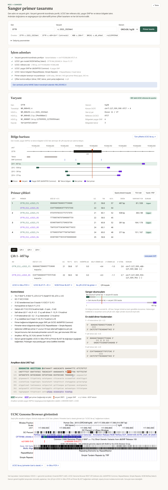

# Sanger primer tasarımı (NGS varyant doğrulama ve segregasyon)

Araçta iki bölüm var:

- **SNV / küçük indel:** Gen adı ve varyant girilir. Varyant genomik koordinata çevrilir, UCSC'den bölge verisi alınır, alternatifli Sanger primer çiftleri tasarlanır ve kontrol edilir.
- **CNV / yapısal varyant:** Delesyon, duplikasyon, inversiyon veya translokasyon girilir. Araç uygun doğrulama testini önerir ve kesim noktası (junction), long-range ve qPCR/ddPCR primerlerini tasarlar.

Her iki bölümde tasarlanan primerler için reaksiyon karışımı ve döngü programı önerilir. Sunucu gerektirmez: statik bir sayfadır ve tüm hesaplama tarayıcıda yapılır.



## Kullanım

- GitHub Pages açıksa: `https://<kullanıcı>.github.io/reanaliz/primer/`
- Yerelde:

```bash
cd reanaliz && python3 -m http.server 8000
```

Ardından tarayıcıda `http://localhost:8000/primer/` adresini açın.

Bağlantı ile doğrudan çalıştırma da mümkündür: `primer/?gene=CFTR&variant=c.1521_1523del&build=hg38`

### Kabul edilen varyant gösterimleri

| Girdi | Örnek | Çözümleyen |
|---|---|---|
| Gen + c. gösterimi | `CFTR` + `c.1521_1523del` | VariantValidator (MANE Select) |
| Transkriptli HGVS | `NM_000492.4:c.489+1G>T` | VariantValidator |
| rsID | `rs113993960` | Ensembl REST |
| Genomik koordinat | `chr7:117559590 ATCT>A` | Doğrudan |

GRCh38/hg38 ve GRCh37/hg19 desteklenir.

## CNV / yapısal varyant bölümü

### Girdi

| Girdi | Örnek |
|---|---|
| Genomik aralık | `chrX:31950000-32100000` |
| HGVS g. | `NC_000023.11:g.31950000_32100000del` |
| Gen + ekzon aralığı | `DMD` + `ex45-50` |
| Translokasyon | `chr9:130800000` ve `chr22:23290000` |

Kesim noktası çözünürlüğü üç şekilde verilir:

- **Kesin:** WGS, split-read veya uzun okuma ile baz düzeyinde biliniyor.
- **Ekzon düzeyi:** WES/CES/panel CNV. Kesim noktası, etkilenen ilk/son ekzon ile komşu etkilenmemiş ekzon arasında kabul edilir.
- **Elle belirsizlik:** Array, MLPA vb. Her kesim noktasına ± aralık uygulanır.

### Yöntem

Her kesim noktasının iki yanına birer primer yerleştirilir: solda sağa bakan L, sağda sola bakan R. Varyant tipine göre testler bu dört primerin kombinasyonlarıdır:

| Tip | Junction testi | Normal allel kontrolü |
|---|---|---|
| Delesyon | L1 + R2 (yalnızca delesyonlu allelde) | L1 + R1, L2 + R2 |
| Tandem duplikasyon | L2 + R1 (referansta dışa bakar) | L1 + R1, L2 + R2 |
| İnversiyon | L1 + L2 ve R1 + R2 | L1 + R1, L2 + R2 |
| Translokasyon | L1 + R2, L2 + R1 (ters yönelim: L1 + L2, R1 + R2) | L1 + R1, L2 + R2 |

Beklenen ürün boyu kesim noktası belirsizliğine göre aralık olarak verilir. Ürün ≤ 3 kb ise standart PCR, ≤ 15 kb ise long-range PCR primerleri (24–32 baz, Tm ~65 °C) tasarlanır. Daha büyükse junction PCR uygulanamaz olarak işaretlenir. Dört primer aynı tüpte kullanılabilecek şekilde çapraz dimer açısından birlikte kontrol edilir ve birbirinden farklı üç alternatif set sunulur.

Delesyon ve duplikasyonlarda etkilenen bölge içinde (öncelikle ekzonlarda) qPCR/ddPCR doz primerleri tasarlanır. Junction PCR uygulanamıyorsa ve belirsizlik penceresi ≤ 300 kb ise kesim noktasını daraltmak için qPCR walking noktaları önerilir. Segmental duplikasyon içine düşen noktalar atlanır, çünkü qPCR paralogları ayırt edemez.

### Kesim noktasını veriden bulma

Yapısal varyant bölümünün üstündeki panelde kesim noktası iki yoldan bulunabilir. Bulunan aday "Bu adayı kullan" ile forma aktarılır ve test önerisi ile primer tasarımı başlar.

**BAM kesiti (önerilen).** BAM dosyası tarayıcıda okunur ve hiçbir yere gönderilmez. Küçük bir kesit yüklenebilir ya da büyük BAM, `.bai` indeksiyle birlikte seçilip bölge girilerek yalnızca o bölge okunur. Kanıtlar:

- **Bölünmüş okumalar (SA etiketi):** kesim noktasını baz düzeyinde ve eş kesim noktasını verir.
- **Yumuşak kırpma kümeleri:** aynı noktada biten kırpılmış okumalar; SA etiketi yazmayan hizalayıcılarda da kesim noktasını verir. Kırpılmış dizinin uzlaşısı BLAT bağlantısıyla gösterilir.
- **Anormal okuma çiftleri:** insert boyu ve yönelime göre delesyon, tandem duplikasyon, inversiyon ve translokasyon.
- **Kapsam:** delesyon/duplikasyon içindeki kapsam oranı ve heterozigot/homozigot tahmini. Kesim noktası kanıtı olmayan WGS kesitlerinde kapsam tabanlı aday da üretilir.

Genom sürümü BAM başlığındaki kromozom 1 uzunluğundan belirlenir. CRAM desteklenmez; `samtools view -b` ile BAM'e çevrilmelidir.

**IGV ekran görüntüsü.** Görüntü, kullanıcının kendi Anthropic API anahtarıyla doğrudan Claude'a gönderilir (varsayılan model Claude Opus 5.5). Model konum kutusunu ve cetveli okuyup kapsam, okuma çifti renkleri ve kırpılmış bazlardan aday ve kesim noktası aralıkları çıkarır. Sonuç düzenlenebilir; UCSC'den aralıktaki genler gösterilir. Görüntüden okunan koordinatlar ekran çözünürlüğüyle sınırlı olduğundan aday her zaman belirsizlik aralığıyla aktarılır. Göndermeden önce görüntü üzerinde hasta kimliği karartılabilir ve kimlik bilgisi kalmadığı onaylanmadan gönderim yapılmaz. Bu site anahtarı veya görüntüyü saklamaz; anahtar istenirse yalnızca kullanıcının tarayıcısında tutulur.

### Test önerisi

Öneri varyant tipine, boyuta, kesim noktası kesinliğine, junction PCR'ın uygulanabilirliğine ve kesim noktalarında segmental duplikasyon olup olmadığına göre oluşturulur. Kapsanan yöntemler: junction PCR + Sanger, gap-PCR, long-range PCR, qPCR/ddPCR, MLPA, CMA, karyotip/FISH, OGM, uzun okuma dizileme, RNA/cDNA analizi ve segregasyon/aile danışmanlığı notları.

## PCR koşulu önerisi

| Test | Polimeraz sınıfı | Bağlanma | Uzama |
|---|---|---|---|
| Sanger / junction | Hot-start Taq | en düşük Tm − 3 °C, ±3 °C gradyan | 72 °C, ≈1 dk/kb |
| Long-range | LongAmp, PrimeSTAR GXL vb. | Tm ≥ 63.5 °C ise iki aşamalı 68 °C | 68 °C, ≈1 dk/kb |
| qPCR | SYBR master mix | 60 °C | iki aşamalı, erime eğrisi |

GC > %60 amplikonlarda DMSO/betain eklenmesi ve bağlanmanın 2.5 °C düşürülmesi önerilir. Primer Tm farkı büyükse touchdown programı verilir. Öneriler başlangıç noktasıdır; polimeraz üreticisinin protokolü ve laboratuvar validasyonu esastır.

## İş akışı (SNV / küçük indel)

1. **Varyant çözümleme.** HGVS gösterimi VariantValidator ile doğrulanır ve VCF koordinatına çevrilir. Protein değişikliği ve uyarılar da alınır.
2. **UCSC verisi** (UCSC REST API):
   - NCBI RefSeq Select gen modeli: ekzon/intron numarası, girilen gen adı ile tutarlılık
   - Referans dizi: varyantın REF alleli referansla karşılaştırılır
   - dbSNP155 Common: primer bağlanma yerlerinde yaygın SNP (allel düşmesi riski)
   - RepeatMasker ve Simple Repeats: tekrar bölgeleri
3. **Tasarım.** Varyantın iki yanındaki tüm olası primerler taranır, filtrelenir ve Primer3 tarzı ceza puanı ile sıralanır. Birbirinden en az 10 baz farklı konumda olan alternatif çiftler seçilir. Sıkı kriterlerle yeterli çift çıkmazsa kriterler kontrollü olarak gevşetilir ve bu çiftler arayüzde işaretlenir.
4. **Kontrol.** Her çift için kontrol listesi, dimer hizalamaları, Sanger okuma planı ve işaretli amplikon dizisi gösterilir.
5. **UCSC görselleştirme.** Bölge haritası, UCSC Genome Browser görüntüsü ve primerlerin özel iz olarak yüklendiği UCSC bağlantısı verilir.

## Kontroller

- Tm, GC oranı, 3' GC kenetlenmesi, homopolimer ve dinükleotit tekrarı
- Hairpin, self-dimer, 3' uç self-dimer, F×R heterodimer ΔG ve 3' uç stabilitesi
- Primerde yaygın SNP (sıkı modda hiç yok, gevşek modda 3' son 5 bazda yok)
- Primerin tekrar bölgesine denk gelmesi
- Şablon içinde primer 3' ucunun (12 baz) başka bir yere bağlanması
- Varyantın her iki primerden en az belirlenen mesafede olması (varsayılan 60 baz; Sanger izinin ilk ~40 bazı okunamaz)
- Primer ile varyant arasında homopolimer (≥9 baz) olması
- Amplikon GC oranı
- İsteğe bağlı: varyantın bulunduğu ekzonun tamamını kapsama

## Doğrulama

`tests/` klasöründeki testler ağ gerektirmez:

```bash
node primer/tests/compare.js
```

```bash
node primer/tests/design.test.js
```

```bash
node primer/tests/sv.test.js
```

```bash
node primer/tests/bam.test.js
```

`compare.js` motoru Primer3 (primer3-py 2.4.0) ile 608 oligo üzerinde karşılaştırır. Referans değerler `make_reference.py` ile üretilir.

| Ölçüm | Primer3 ile fark |
|---|---|
| Tm | 0.000 °C (birebir aynı) |
| Heterodimer ΔG | ortalama 0.5 kcal/mol, korelasyon r = 0.89 |
| Self-dimer ΔG | ortalama 0.8 kcal/mol, korelasyon r = 0.93 |
| Hairpin ΔG | ortalama 0.3 kcal/mol, korelasyon r = 0.92 |

`design.test.js` CFTR c.1521_1523del (F508del) bölgesinin kaydedilmiş UCSC verisi üzerinde tüm kısıtların sağlandığını doğrular.

`sv.test.js` delesyon, duplikasyon ve inversiyon için primer konumlarını, beklenen ürün boylarını ve PCR koşullarını test eder. Ayrıca mutant alleli bilgisayarda oluşturup sanal PCR yapar. Öngörülen ürün boylarının, primerlerin mutant ve referans dizideki gerçek bağlanma yerleriyle birebir aynı olduğunu doğrular.

`bam.test.js` gerçek hg38 dizisi üzerinde simüle edilmiş BAM dosyalarında (heterozigot ve homozigot delesyon, tandem duplikasyon, inversiyon, translokasyon) kesim noktası bulucuyu test eder. Dosyalar `make_bams.py` ile üretilir; gerçek kesim noktaları `bam/truth.json` içindedir. Beş senaryonun tamamında tip, iki kesim noktası (±1 bp), zigosite ve güven doğru bulunur. SA etiketi olmayan hizalayıcı senaryosu ve varyantsız bölgede yanlış pozitif olmaması da test edilir.

Gerçek veri doğrulaması (ağ ve pysam gerekir): `tests/giab/fetch_giab.py` GIAB HG002 Tier1 v0.6 listesinden 6 delesyonun BAM kesitlerini indirir, `tests/giab/run_giab.js` sonuçları karşılaştırır. SA etiketi yazmayan novoalign hizalamasıyla sonuçlar:

| GIAB delesyonu | Sonuç |
|---|---|
| 1.1 kb het, 1.2 kb het, 4.1 kb hom, 3.1 kb hom | Doğru tip ve zigosite; iki kesim noktası 0–15 bp içinde, yüksek güven |
| 6.1 kb hom (karmaşık bölge) | Homozigot delesyon, orta güven; bir kenar ~850 bp kayık |
| 1.5 kb tekrar daralması | Delesyon, düşük güven, yaklaşık konum |

## Sınırlamalar

- **Genom geneli özgüllük tarayıcıdan otomatik yapılamaz.** UCSC BLAT ve In-Silico PCR programatik erişimi engelliyor. Her çift için hazır doldurulmuş UCSC In-Silico PCR, BLAT ve NCBI Primer-BLAST bağlantıları verilir. Sipariş öncesi bu kontrol mutlaka yapılmalıdır. Psödogeni veya paralogu olan genlerde (ör. SMN1/SMN2, PMS2, CYP21A2, GBA1) bu adım özellikle kritiktir.
- İkincil yapı ΔG değerleri Primer3'ün termodinamik hizalamasının yaklaşık karşılığıdır. Eşik kontrolü ve sıralama için yeterlidir, ancak mutlak değerler birkaç kcal/mol farklı olabilir.
- SNP maskesi dbSNP155 Common'a (MAF ≥ %1) dayanır. Nadir popülasyona özgü varyantlar bu izde bulunmayabilir.
- Varyant ekzonun tamamını kapsama seçeneğinde ekzon, maksimum ürün boyuna sığmalıdır.
- Ekzon düzeyi CNV'de kesim noktası penceresi RefSeq Select ekzonlarına göre hesaplanır. Yakalama kitinizin hedefleri farklıysa elle belirsizlik seçeneğini kullanın.
- Duplikasyon junction testi tandem ve aynı yönlü duplikasyonu varsayar. Ters yönlü veya başka lokusa eklenmiş duplikasyonlarda ürün vermez.
- MLPA kitinin varlığı kontrol edilmez; öneri "kit varsa" şeklindedir.
- BAM analizi kesitteki okumalarla sınırlıdır. WES/panel verisinde kesim noktası yakalanmayan intronda ise bölünmüş okuma ve kırpma görülmez; bu durumda ekzon düzeyi mod kullanılmalıdır. Tekrar dizileri içindeki kesim noktaları kayık veya belirsiz çıkabilir.
- IGV görüntüsü yorumu bir yapay zekâ modelinin tahminidir ve doğrulanmalıdır. Kullanıcının API anahtarı ve kurumunun KVKK onayı gerekir.

## Dosyalar

| Dosya | İçerik |
|---|---|
| `index.html` | Arayüz |
| `app.js` | SNV bölümü: veri toplama (VariantValidator, Ensembl, UCSC) ve görselleştirme |
| `sv.js` | CNV / yapısal varyant bölümü: test önerisi, şema, junction ve doz primerleri |
| `bam.js` | BAM/BAI okuyucu ve kesim noktası kanıt analizi (tarayıcı ve Node.js) |
| `evidence.js` | BAM kesiti ve IGV ekran görüntüsü paneli |
| `engine.js` | Termodinamik, primer tasarımı, yapısal varyant testleri ve PCR koşulları (tarayıcı ve Node.js) |
| `tests/` | Primer3 karşılaştırması, tasarım, yapısal varyant ve BAM testleri; sentetik BAM üretici; GIAB doğrulama betikleri |
